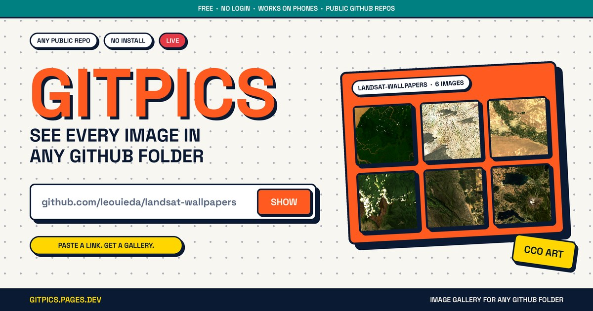

<div align="center">



# 🖼️ GitPics

### GitHub shows you file names. GitPics shows you the *pictures.*

**Paste any GitHub repo or folder link → get a thumbnail gallery. No login. No install. Works on your phone.**

[**🚀 Open GitPics**](https://gitpics.pages.dev) &nbsp;·&nbsp; [**🐛 Report a bug**](../../issues) &nbsp;·&nbsp; [**⭐ Star it (please)**](../../stargazers)


</div>

---

## 😤 The problem

You open a GitHub folder with 1,000 wallpapers and see this:

```
📄 0163.jpg
📄 0172.jpg
📄 01r583.jpg
📄 ...(997 more generic file icons)
```

Click, back, click, back. Your thumb is filing for divorce.

## ✨ The fix

Paste the folder link into **GitPics** and it turns into a gallery: every image as a thumbnail, in its **real aspect ratio** (portrait stays portrait, ultrawide stays ultrawide), with a swipeable full-screen viewer and one-tap download.

## ⚡ Try it in 10 seconds

> The one and only official GitPics lives at **[gitpics.pages.dev](https://gitpics.pages.dev)**. Nothing to download, nothing to set up. Just open it.

1. Copy any GitHub repo or folder link
2. Paste it into [GitPics](https://gitpics.pages.dev) and hit **SHOW**
3. Scroll. Swipe. Download. Done.

**Pro shortcut:** put `https://gitpics.pages.dev/#` in front of any GitHub link and open it. Instant gallery, no pasting.

```
https://gitpics.pages.dev/#https://github.com/leouieda/landsat-wallpapers
```

## 🔥 Features

| | |
|---|---|
| 🖼️ **Real aspect ratios** | Portrait, wide, 2K, 4K. Nothing gets cropped (square mode is one tap away) |
| 👆 **Swipe viewer** | Drag with your finger or use the buttons. Image and filename always change together |
| ⚡ **Fast on mobile** | Thumbnails and viewer images are resized on the fly, so a 5 MB wallpaper doesn't eat your data. Download still gives you the original |
| 📁 **Folder navigation** | Open subfolders, go back up, switch the grid between S / M / L |
| 🕘 **Recent + Popular** | Remembers what you opened and suggests popular wallpaper repos, all by itself |
| 🔗 **Shareable links** | Copy a link to any gallery and send it to anyone |
| 🌗 **Light / dark** | Neo-brutalist theme with a dotted background and a theme toggle |
| 🔒 **No login, no tracking** | Runs entirely in your browser. No backend, no accounts |

## 🧠 How it works

- Reads the folder with GitHub's public **Git Trees API** (one request per folder)
- Loads images straight from `raw.githubusercontent.com`
- Makes thumbnails through the free [wsrv.nl](https://wsrv.nl) image resizer, and falls back to the original file if it's unavailable
- Saves your recent folders in your own browser's `localStorage`. Nothing is sent anywhere

## ⚠️ Honest limits

- **Public repos only.** Private repos need a login, and GitPics doesn't do logins
- **GitHub's API allows 60 requests per hour per person.** Each folder you open costs one, which is plenty for normal browsing
- **Images stored with Git LFS won't show.** GitHub serves those differently
- **Huge folders:** GitHub itself caps very large listings, so GitPics can only show what it returns
- Layout may shift a little while images load, because GitHub doesn't tell us an image's size in advance

## 🥺 The part where I beg

Look, I built this so you'd never have to click a file named `a_black_and_white_drawing_of_a_woman_in_a_black_and_white_...png` again.

All I ask in return is **one tiny star** ⭐

If you don't star it:
- 🐌 Your next `git clone` will feel 3% slower (not scientifically proven, but do you want to risk it?)
- 😢 This README will cry in a corner
- 🧦 A sock will go missing from your laundry. Not mine. Yours.
- 👀 I will know. (I will not know. But I'll *feel* it.)

If you **do** star it:
- 🚀 Instant good karma
- 🧠 Your taste in tools is officially immaculate
- 🥇 You are a legend and the README says thank you

> **[⭐ Click here. It takes one second. Your wallpaper folder will thank you.](../../stargazers)**

## 🤝 Contributing

Found a bug? Got an idea? Open an [issue](../../issues) and it will make GitPics better for everyone.

Ideas that would be cool:
- [ ] Select several images and download them together
- [ ] Better support for huge folders
- [ ] Slideshow mode
- [ ] Keyboard shortcuts cheat sheet

## 🙏 Credits

- Share-image photos: "Amazon delta" and other Landsat wallpapers from [leouieda/landsat-wallpapers](https://github.com/leouieda/landsat-wallpapers), made from public-domain Landsat data and released under **CC0**
- Thumbnails by [wsrv.nl](https://wsrv.nl)
- Typeface: [Space Grotesk](https://fonts.google.com/specimen/Space+Grotesk)
- GitPics is **not affiliated with GitHub**. Images belong to their repo owners

## 📜 License

Released under the [MIT License](LICENSE).

<div align="center">

**Made with ☕, mild frustration, and a lot of unnecessary box-shadows.**

⭐ *Star this repo and make the README happy* ⭐

</div>
